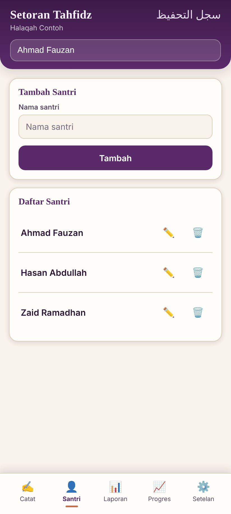

# Setoran Tahfidz

**Setoran Tahfidz** membantu santri mencatat setoran hafalan Al-Qur'an.
Aplikasi berjalan secara offline dan menyimpan data di `localStorage`
perangkat, tanpa backend atau koneksi internet.

Aplikasi web-nya ada di `www/index.html` dan dibungkus menjadi aplikasi
Android dengan [Capacitor](https://capacitorjs.com/). Proyek ini bisa
dibangun menjadi APK untuk pengujian atau AAB untuk Google Play Store.

- **Nama tampilan:** Setoran Tahfidz
- **Application ID:** `id.tahfidz.setoran`
- **Web dir:** `www/`
- **Native project:** `android/`

## Fitur

- **Catat setoran harian:** tahsin, tahfidz, murojaah, dan keterangan (Izin, Sakit, Ghoib), dengan navigasi per tanggal. Rentang ayat diisi per baris (bisa lebih dari satu) dan divalidasi dengan jumlah ayat tiap surah; catatan Iqro tetap berupa teks bebas dan tidak dibaca Progres.
- **Kelola santri:** tambah, ganti nama, dan hapus santri.
- **Laporan bulanan:** tabel per bulan dengan total, bisa diunduh sebagai gambar dan diberi watermark lembaga.
- **Progres:** diagram perkembangan hafalan per santri, dibaca dari rentang ayat terstruktur (surah + ayat awal sampai surah + ayat akhir, bisa lintas surah, mis. Al-Baqarah 200 → Ali 'Imran 23; teks lama tetap terbaca): total ayat dan surah tuntas, hafalan baru per minggu atau bulan, serta total dari waktu ke waktu. Ada juga progres per juz (30 juz, Mushaf Madinah/Hafs; rentang lintas surah/juz dipecah per ayat). Penulisan ayat yang di luar jumlah ayat surah tidak dihitung dan ditandai.
- **Setelan:** mode terang, gelap, atau otomatis; lima warna tema; ukuran teks; saran nama surah; pengingat cadangan.
- **Cadangan data:** ekspor dan impor data sebagai file JSON.
- **Offline:** data tersimpan di perangkat dan aplikasi tidak butuh koneksi internet.

## Tangkapan layar

Semua nama dan catatan pada gambar ini fiktif.

| Catat | Santri | Laporan | Setelan |
| --- | --- | --- | --- |
|  |  |  |  |  |

## Tentang proyek

- **Pemilik:** Abu Ja'far Putra Arsad
- **Peran saya:** Saya menentukan fitur dan menguji aplikasi ini. Kode ditulis dengan bantuan AI.
- **Status:** Uji coba. Aplikasi tersedia sebagai APK debug dan belum dirilis ke Google Play.
- **Privasi:** aplikasi tidak mengumpulkan data pengguna. Lihat [PRIVACY_POLICY.md](PRIVACY_POLICY.md).
- **Lisensi:** [MIT](LICENSE)

## Menjalankan di browser

`www/index.html` bisa dibuka langsung di browser:

```powershell
start www\index.html
```

Jika browser membatasi akses melalui `file://`, jalankan server lokal:

```powershell
npx serve www
```

## Struktur proyek

```
www/index.html          # Aplikasi web (HTML+CSS+JS inline, self-contained)
capacitor.config.json    # Konfigurasi Capacitor (appId, appName, webDir)
android/                 # Proyek Android native (dibuat oleh `npx cap add android`)
assets-src/              # Source gambar 1024x1024 untuk ikon & splash (generate_icon.py)
resources/               # Input untuk @capacitor/assets (icon.png, splash.png, dst.)
release-signing/         # Panduan membuat upload keystore & signing config (README.md)
PRIVACY_POLICY.md        # Kebijakan privasi (dibutuhkan untuk Play Store)
```

## Setup awal

Perintah berikut sudah dijalankan untuk menyiapkan proyek. Jalankan lagi
jika ingin mengulang setup:

```powershell
npm install
npx cap init "Setoran Tahfidz" "id.tahfidz.setoran" --web-dir www
npx cap add android
npx capacitor-assets generate --android   # dari resources/icon.png & resources/splash.png
```

## Membuka proyek di Android Studio

1. Install [Android Studio](https://developer.android.com/studio), termasuk
   Android SDK dan JDK yang kompatibel.
2. Di Android Studio, pilih **File → Open** lalu buka folder `android/`.
3. Tunggu proses Gradle sync selesai.
4. Klik **Run ▶** untuk menjalankan aplikasi di emulator atau perangkat.
   Gunakan menu **Build** untuk membuat APK atau AAB.

Setelah mengubah `www/index.html`, jalankan `npx cap sync android` agar
perubahannya disalin ke `android/app/src/main/assets/public`.

## Membuat Debug APK

Gunakan JDK 21 dan Android SDK dengan build-tools serta platform yang sesuai
`android/variables.gradle` (saat ini `compileSdk`/`targetSdk` 36 dan
`minSdk` 24).

```powershell
cd android
$env:JAVA_HOME = "<path ke JDK 21>"
.\gradlew.bat assembleDebug
```

Output: `android/app/build/outputs/apk/debug/app-debug.apk`

Build ini telah berhasil dijalankan di lingkungan pengembangan proyek dengan
JDK Temurin 21 dan Android SDK build-tools 35/36.

## Membuat Release AAB

Google Play mewajibkan **Android App Bundle (.aab)** yang ditandatangani
dengan upload key milik Anda. Ikuti petunjuk di `release-signing/README.md`
untuk membuat keystore dan `android/keystore.properties`, lalu jalankan:

```powershell
cd android
.\gradlew.bat bundleRelease
```

Output: `android/app/build/outputs/bundle/release/app-release.aab`

> Keystore tidak disertakan di repo dan jangan di-commit. Buat keystore
> sendiri dan simpan dengan aman.

## Rilis ke Google Play Store

Ikuti langkah berikut untuk menyiapkan aplikasi:

1. Buat akun developer di [Google Play Console](https://play.google.com/console/).
   Biaya pendaftaran satu kali sebesar **USD 25** dan verifikasi identitas
   berlaku.
2. Pilih **Create app**, lalu isi nama "Setoran Tahfidz", bahasa Indonesia,
   kategori (misalnya Pendidikan/Education), dan status gratis (Free).
3. Lengkapi Store Listing:
   - Deskripsi singkat maksimal 80 karakter dan deskripsi lengkap maksimal
     4000 karakter, dalam Bahasa Indonesia. Jelaskan pencatatan setoran,
     penyimpanan lokal/offline, serta bahwa aplikasi tidak memakai iklan
     atau akun.
   - Minimal **2 screenshot ponsel** dalam format PNG/JPEG, rasio 16:9 atau
     portrait, sisi terpanjang 320–3840 px. Ambil screenshot dari emulator
     atau perangkat.
   - **Feature graphic** berukuran 1024x500 px.
   - Ikon listing berukuran 512x512 px. Ekspor `assets-src/icon-1024.png`
     lalu ubah ukurannya; ikon adaptif hasil build tidak menggantikan ikon
     listing ini.
4. Isi **Content Rating Questionnaire** sesuai kondisi aplikasi untuk
   mendapatkan rating usia.
5. Isi **Data Safety form** sesuai perilaku aplikasi: data tidak dikumpulkan
   atau dibagikan dan hanya tersimpan di perangkat (`localStorage`), tanpa
   dikirim ke server. Gunakan `PRIVACY_POLICY.md` sebagai referensi.
6. Publikasikan `PRIVACY_POLICY.md` di halaman web publik, misalnya GitHub
   Pages atau hosting statis lain. Masukkan URL-nya di **App content →
   Privacy Policy**.
7. Mulai dari **Internal testing** melalui **Release → Testing → Internal
   testing → Create new release**, lalu tambahkan email penguji.
8. Unggah `app-release.aab` hasil `bundleRelease` yang sudah ditandatangani.
9. Lengkapi rollout dan release notes, lalu kirim untuk ditinjau Google.
   Setelah pengujian internal, Anda bisa mempromosikan rilis ke **Production**;
   rilis ini juga perlu ditinjau Google.

Pembuatan akun, verifikasi identitas, pembayaran, screenshot dari perangkat,
dan persetujuan rilis harus dilakukan sendiri melalui akun Google Play Console.

## Ikon dan splash screen

Ikon dan splash screen saat ini masih placeholder: latar ungu plum
(`#5b2a6b`), motif buku terbuka, tanda centang emas, dan monogram "ST".
File dibuat oleh `assets-src/generate_icon.py` (Python + Pillow), lalu
`@capacitor/assets` menghasilkan ikon mipmap ldpi–xxxhdpi, adaptive icon,
serta splash screen untuk berbagai densitas dan orientasi.

Untuk memakai desain sendiri, ganti `resources/icon.png`,
`resources/icon-foreground.png`, `resources/icon-background.png`, dan
`resources/splash.png`, lalu jalankan:

```powershell
npx capacitor-assets generate --android
```

## Izin aplikasi

Aplikasi ini tidak meminta izin khusus. Karena berjalan offline,
`AndroidManifest.xml` tidak berisi izin `INTERNET` atau izin lainnya.
