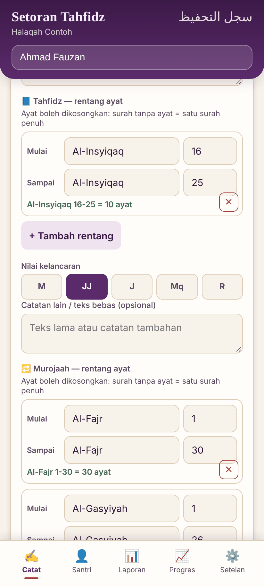
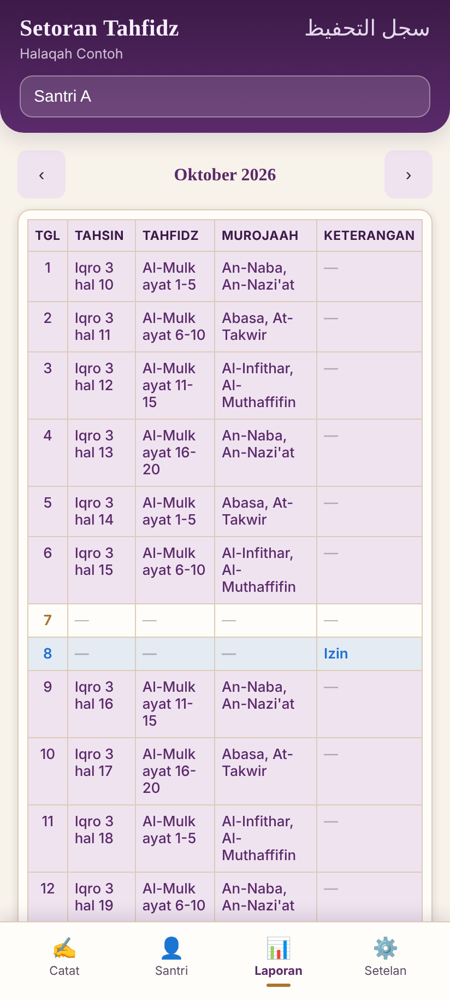
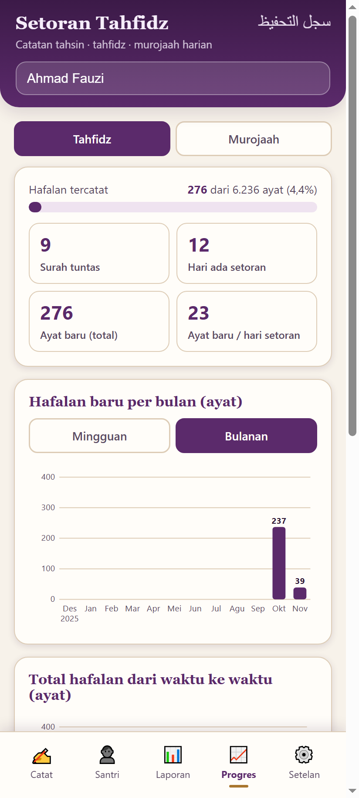
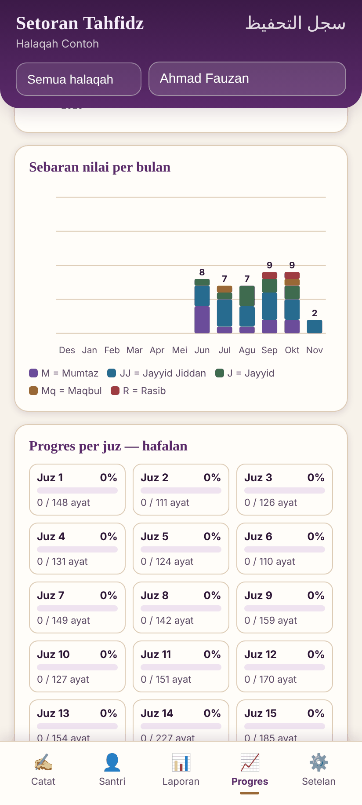
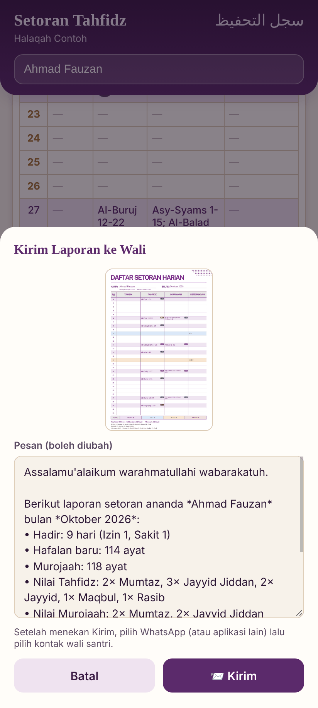
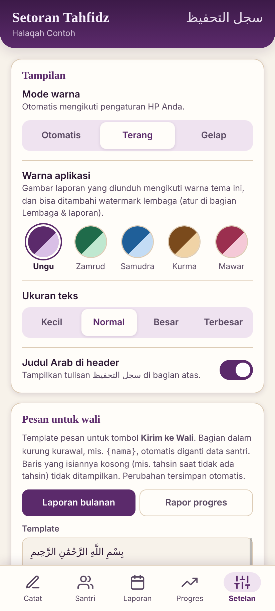
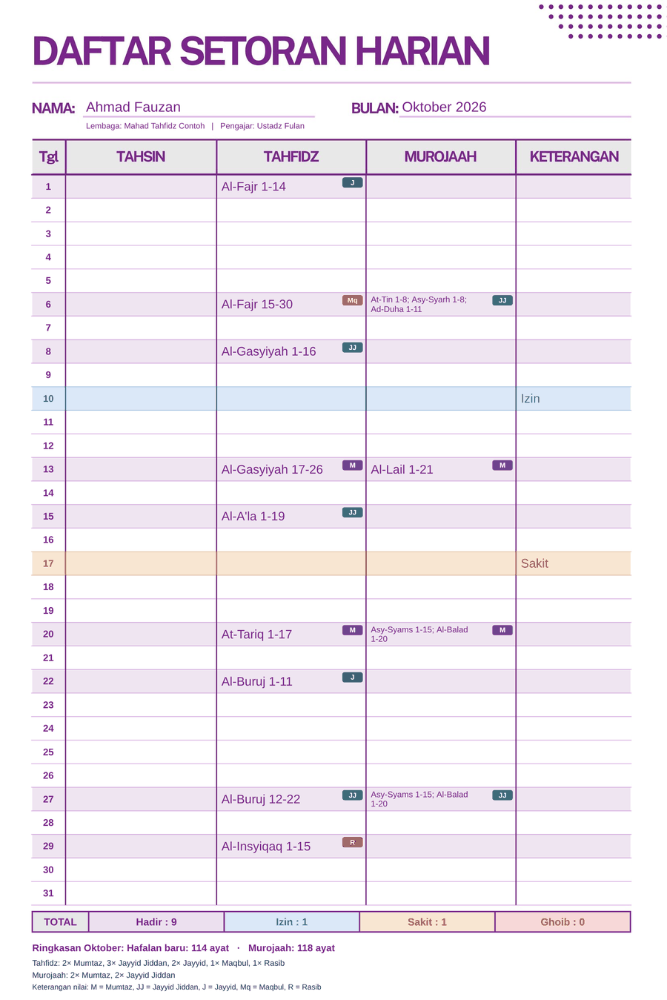
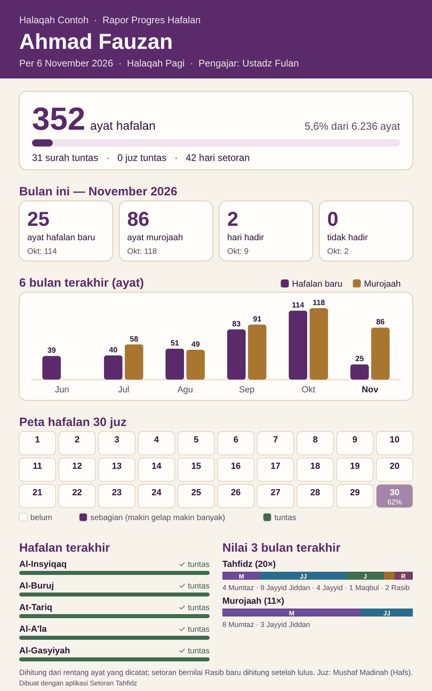

# Setoran Tahfidz

Aplikasi Android untuk **guru tahfidz** mencatat setoran hafalan Al-Qur'an
santri setiap hari: tahsin, tahfidz, dan murojaah, lengkap dengan nilai
kelancaran, laporan bulanan, dan diagram progres hafalan.

Aplikasi berjalan **sepenuhnya offline**. Tidak perlu akun, tidak ada iklan,
dan data tidak pernah dikirim ke server mana pun.

**[⬇️ Unduh APK terbaru](https://github.com/abujafar-arsyad/setoran-tahfidz/releases/latest)** · versi uji coba · [Riwayat rilis](https://github.com/abujafar-arsyad/setoran-tahfidz/releases)

## Tangkapan layar

Semua nama dan catatan pada gambar ini fiktif.

| Catat | Laporan | Progres | Sebaran nilai |
| :---: | :---: | :---: | :---: |
|  |  |  |  |

| Kirim ke wali | Setelan | Laporan bulanan (gambar) | Rapor progres (gambar) |
| :---: | :---: | :---: | :---: |
|  |  |  |  |

## Fitur

**Pencatatan harian**
- Catat tahsin, tahfidz, murojaah, dan keterangan (Izin, Sakit, Ghoib) per tanggal.
- Rentang ayat diisi per baris: surah dan ayat awal sampai surah dan ayat akhir. Bisa lebih dari satu baris, dan bisa lintas surah (mis. Al-Baqarah 200 → Ali 'Imran 23).
- Ayat boleh dikosongkan: surah tanpa nomor ayat dihitung satu surah penuh.
- Nama surah muncul sebagai saran saat mengetik, dan jumlah ayat dicek otomatis (mis. Al-Ikhlas hanya 1–4).
- Nama surah yang diketik dengan huruf Arab tersimpan dan tampil dalam huruf Arab (mis. البلد ١-٧).
- **Lanjut dari ayat terakhir:** tiap kategori menampilkan setoran terakhir santri; untuk Tahfidz ada tombol **Lanjut ayat N** yang langsung mengisi surah dan ayat awal (atau **Ulang** bila setoran terakhir bernilai Rasib).
- Catatan Iqro atau buku lain tetap bisa ditulis sebagai teks bebas.

**Nilai kelancaran**
- Setiap kategori setoran bisa diberi nilai (tidak wajib):

  | Singkatan | Nilai | | Keterangan |
  | :---: | --- | :---: | --- |
  | M | Mumtaz | ممتاز | lulus |
  | JJ | Jayyid Jiddan | جيد جدا | lulus |
  | J | Jayyid | جيد | lulus |
  | Mq | Maqbul | مقبول | lulus |
  | R | Rasib | راسب | belum lulus |

- Nilai tampil sebagai label berwarna di tabel Laporan dan di gambar laporan.

**Laporan bulanan**
- Tabel per bulan dengan total Hadir, Izin, Sakit, dan Ghoib. Ketuk satu hari untuk mengedit.
- Unduh sebagai gambar untuk dikirim ke wali santri, lengkap dengan nama lembaga, nama pengajar, ringkasan ayat bulan itu (hafalan baru, murojaah, tahsin), rekap nilai, dan watermark lembaga (opsional).

**Progres hafalan**
- Ringkasan per santri: ayat tercatat dari 6.236 ayat, surah tuntas, hari setoran, dan rata-rata ayat per hari.
- Diagram hafalan baru per pekan atau per bulan, total dari waktu ke waktu, dan sebaran nilai per bulan.
- Progres per surah dan per juz (30 juz, Mushaf Madinah riwayat Hafs).
- Bisa dilihat untuk Tahsin, Tahfidz, atau Murojaah.
- **Unduh Progres** membuat rapor satu halaman untuk wali santri: total hafalan, perbandingan bulan ini dengan bulan lalu, kehadiran, diagram 6 bulan, peta 30 juz, hafalan terakhir, rekap nilai, dan catatan tahsin terakhir.

**Kirim ke wali**
- Tombol **Kirim Laporan ke Wali** (tab Laporan) dan **Kirim Rapor ke Wali** (tab Progres) membagikan gambar laporan/rapor **bersama pesan pembuka** yang sudah tersusun: basmalah, salam, kehadiran, hafalan baru, murojaah, nilai, dan nama pengajar.
- Hafalan disebut **per surah**, bukan hanya jumlah ayat. Contoh: *"Alhamdulillah, ananda sudah hafal 2 surah dan 6 ayat, yaitu Al-'Alaq ayat 1–6, Al-Qadr, dan Al-Bayyinah."* Juz yang sudah tuntas ditulis singkat, mis. "Juz 30".
- Pesan bisa diubah dulu, lalu pilih WhatsApp dan kontak wali. WhatsApp memakai pesan itu sebagai keterangan gambar.
- **Template pesan bisa diedit dan tersimpan** di **Setelan → Pesan untuk wali** (terpisah untuk laporan bulanan dan rapor progres). Isian seperti `{nama}`, `{hafalan_baru}`, atau `{daftar_hafalan}` disisipkan dengan sekali ketuk, ada pratinjau dengan contoh santri "Fulan", dan bisa dikembalikan ke template bawaan.
- Nama di akhir pesan diambil dari **Setelan → Nama pengajar**.

**Kelompok halaqah (opsional)**
- Mati secara bawaan. Nyalakan di **Setelan → Pencatatan → Kelompok halaqah** bila lembaga Anda punya beberapa kelompok. Bila dimatikan lagi, halaqah hanya disembunyikan dan tetap tersimpan.
- Santri bisa diberi halaqah (mis. Pagi, Sore, Kelas A). Boleh dikosongkan.
- Daftar santri dikelompokkan per halaqah, dan di bagian atas aplikasi ada pilihan halaqah untuk menyaring santri.
- Nama halaqah ikut tercantum di laporan bulanan dan rapor progres.

**Setelan dan data**
- Mode terang, gelap, atau otomatis; lima warna tema; empat ukuran teks; halaman awal saat aplikasi dibuka.
- Ekspor dan impor cadangan data (file JSON), plus pengingat cadangan berkala.

## Cara pakai singkat

1. **Tab Santri:** tambahkan nama santri. Ketuk ✏️ untuk mengubah nama.
2. **Tab Catat:** pilih santri dan tanggal, isi rentang ayat untuk tahsin, tahfidz, atau murojaah, beri nilai bila perlu, lalu ketuk **Simpan Setoran**.
3. **Tab Laporan:** lihat rekap bulanan. Ketuk **Kirim Laporan ke Wali** untuk mengirim gambar laporan beserta pesannya lewat WhatsApp, atau **Unduh Laporan (Gambar)** untuk menyimpannya saja.
4. **Tab Progres:** pantau perkembangan hafalan tiap santri. Ketuk **Kirim Rapor ke Wali** atau **Unduh Progres**.
5. **Tab Setelan:** isi nama lembaga dan pengajar, dan ketuk **Ekspor Data** secara rutin untuk mencadangkan data.

## Cara Progres menghitung

- Angka dihitung dari rentang ayat yang dicatat. Ayat yang disetor ulang tidak menambah total hafalan.
- Setoran Tahfidz bernilai **Rasib** tidak dihitung sampai disetor ulang dengan nilai lulus (atau tanpa nilai).
- Murojaah dan Tahsin bernilai Rasib tidak masuk total ayat, tetapi harinya tetap terhitung sebagai hari setoran.
- Catatan Iqro, nomor halaman, atau tulisan seperti "Juz 30 halaman 3" tidak bisa dibaca sebagai ayat. Progres akan menampilkan peringatan untuk catatan seperti ini.
- Hafalan santri sebelum memakai aplikasi ini tidak ikut terhitung.

## Data dan privasi

- Semua data tersimpan **hanya di HP ini** (`localStorage`). Tidak ada server, akun, iklan, atau pelacak.
- Cadangan otomatis Android dimatikan, sehingga data **ikut terhapus** bila aplikasi di-uninstall atau datanya dihapus. Karena itu, ekspor cadangan secara rutin dari tab Setelan.
- Untuk pindah HP, ekspor cadangan di HP lama lalu impor di HP baru.
- Aplikasi tidak meminta izin khusus apa pun, termasuk izin internet.

Selengkapnya: [Kebijakan Privasi](PRIVACY_POLICY.md).

## Tentang proyek

- **Pemilik:** Abu Ja'far Putra Arsad, pengajar tahfidz Al-Qur'an
- **Peran saya:** menentukan fitur dan menguji aplikasi ini. Kode ditulis dengan bantuan AI.
- **Status:** uji coba. Tersedia sebagai APK debug dan belum dirilis ke Google Play. Bahan rilis Play Store sudah disiapkan di [docs/PLAY_STORE.md](docs/PLAY_STORE.md).
- **Lisensi:** [MIT](LICENSE)

---

## Untuk pengembang

Aplikasi web-nya ada di satu file, `www/index.html`, dan dibungkus menjadi
aplikasi Android dengan [Capacitor](https://capacitorjs.com/).

- **Application ID:** `id.tahfidz.setoran`
- **Web dir:** `www/`
- **Native project:** `android/`

### Struktur proyek

```
www/index.html           # Aplikasi web (HTML + CSS + JS dalam satu file)
tests/                   # Tes logika rentang ayat, progres, nilai, halaqah (npm test)
tests/ui/                # Tes tampilan otomatis lewat Chrome/Edge (npm run test:ui)
docs/screenshots/        # Tangkapan layar untuk README
docs/PLAY_STORE.md       # Panduan rilis ke Google Play Store
docs/play-store/         # Ikon, feature graphic, dan screenshot untuk listing Play Store
docs/privacy-policy.html # Kebijakan privasi versi web (GitHub Pages)
capacitor.config.json    # Konfigurasi Capacitor (appId, appName, webDir)
android/                 # Proyek Android native
assets-src/              # Sumber gambar ikon & splash (generate_icon.py)
resources/               # Input untuk @capacitor/assets
release-signing/         # Panduan membuat upload keystore & signing config
PRIVACY_POLICY.md        # Kebijakan privasi
```

### Menjalankan di browser

`www/index.html` bisa dibuka langsung di browser:

```powershell
start www\index.html
```

Jika browser membatasi akses melalui `file://`, jalankan server lokal:

```powershell
npx serve www
```

### Tes

```powershell
npm test          # tes logika (cepat, tanpa browser)
npm run test:ui   # tes tampilan: membuka aplikasi di Chrome/Edge dan memakainya seperti pengguna
```

Jalankan keduanya sebelum setiap rilis. Semua tes harus lulus.

Tes tampilan tidak butuh paket tambahan. Ia mencari Chrome, Edge, atau
Chromium yang terpasang (perlu Node.js 22 atau lebih baru), lalu mengetuk
layar, mengisi rentang ayat, memberi nilai, mengunduh gambar laporan
(termasuk mengecek nomor tanggalnya), mencoba Kirim ke wali, sakelar halaqah,
dan menguji ekspor–impor. Bila
browser tidak ditemukan, tunjukkan lokasinya:

```powershell
$env:CHROME_PATH = "C:\Program Files (x86)\Microsoft\Edge\Application\msedge.exe"
npm run test:ui
```

Tambahkan `$env:SHOW = "1"` untuk melihat jendela browser saat tes berjalan.

### Membuat Debug APK

Gunakan JDK 21 dan Android SDK dengan build-tools serta platform yang sesuai
`android/variables.gradle` (saat ini `compileSdk`/`targetSdk` 36 dan
`minSdk` 24).

```powershell
npx cap sync android
cd android
$env:JAVA_HOME = "<path ke JDK 21>"
.\gradlew.bat assembleDebug
```

Output: `android/app/build/outputs/apk/debug/app-debug.apk`

`npx cap sync android` wajib dijalankan setiap kali `www/index.html` berubah,
agar perubahannya disalin ke `android/app/src/main/assets/public`.

### Alur rilis

1. Naikkan versi di `android/app/build.gradle`. Polanya: `versionName "1.3.0"` → `versionCode 130`.
2. Jalankan `npm test` dan `npm run test:ui`, lalu build APK seperti di atas
   **di PC yang biasa dipakai**, supaya APK ditandatangani dengan
   `debug.keystore` yang sama (lihat [release-signing/README.md](release-signing/README.md)).
3. Buat GitHub Release dengan tag `vX.Y.Z-debug` dari `main`, unggah APK
   bernama `setoran-tahfidz-vX.Y.Z-debug.apk`, dan tandai sebagai
   **Latest release** agar tautan unduh di atas ikut berpindah.

### Rilis otomatis

Alur [`.github/workflows/rilis-apk.yml`](.github/workflows/rilis-apk.yml) membuat APK dan
GitHub Release sendiri. Setiap ada perubahan di `main`, alur ini membaca `versionName`;
bila rilis `vX.Y.Z-debug` belum ada, ia menjalankan tes, membuild APK, memeriksa bahwa
tanda tangannya sama dengan rilis sebelumnya, lalu merilisnya. Jadi cukup naikkan versi
dan gabungkan ke `main`.

Syaratnya, `debug.keystore` dari PC pemilik disimpan **sekali** sebagai secret
`DEBUG_KEYSTORE_BASE64`. Jalankan di PowerShell pada PC itu (perlu GitHub CLI yang sudah login):

```powershell
[Convert]::ToBase64String([IO.File]::ReadAllBytes("$env:USERPROFILE\.android\debug.keystore")) | gh secret set DEBUG_KEYSTORE_BASE64 -R abujafar-arsyad/setoran-tahfidz
```

Selama secret belum diisi, alur ini hanya memberi peringatan dan tidak membuat apa pun.
Bila tanda tangan APK ternyata berbeda, rilis dibatalkan agar data pengguna tidak hilang.
Alur juga bisa dijalankan manual dari tab **Actions → Rilis APK → Run workflow**.

### Membuat Release AAB

Google Play mewajibkan **Android App Bundle (.aab)** yang ditandatangani
dengan upload key milik Anda. Ikuti petunjuk di `release-signing/README.md`
untuk membuat keystore dan `android/keystore.properties`, lalu jalankan:

```powershell
cd android
.\gradlew.bat bundleRelease
```

Output: `android/app/build/outputs/bundle/release/app-release.aab`

> Keystore tidak disertakan di repo dan jangan di-commit. Buat keystore
> sendiri dan simpan dengan aman.

Langkah lengkap ke Google Play ada di [docs/PLAY_STORE.md](docs/PLAY_STORE.md).

### Membuka proyek di Android Studio

1. Install [Android Studio](https://developer.android.com/studio), termasuk
   Android SDK dan JDK yang kompatibel.
2. Pilih **File → Open** lalu buka folder `android/`.
3. Tunggu proses Gradle sync selesai, lalu klik **Run ▶** untuk menjalankan
   aplikasi di emulator atau perangkat.

### Ikon dan splash screen

Ikon dan splash screen saat ini masih placeholder: latar ungu plum
(`#5b2a6b`), motif buku terbuka, tanda centang emas, dan monogram "ST".
File dibuat oleh `assets-src/generate_icon.py` (Python + Pillow), lalu
`@capacitor/assets` menghasilkan ikon untuk semua densitas.

Untuk memakai desain sendiri, ganti `resources/icon.png`,
`resources/icon-foreground.png`, `resources/icon-background.png`, dan
`resources/splash.png`, lalu jalankan:

```powershell
npx capacitor-assets generate --android
```
